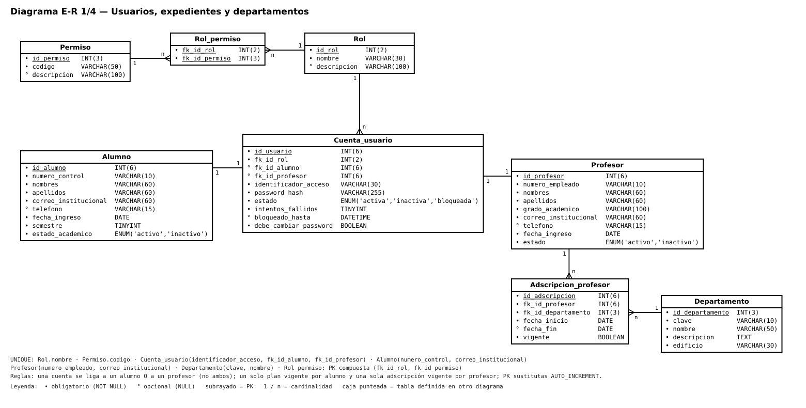
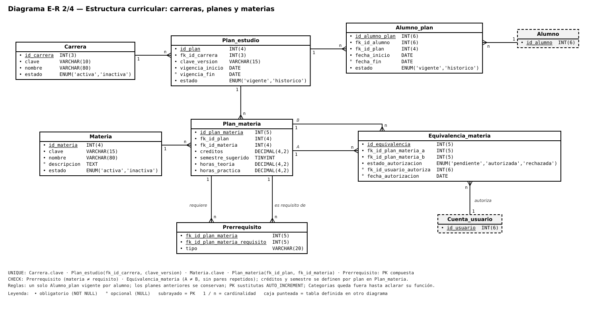
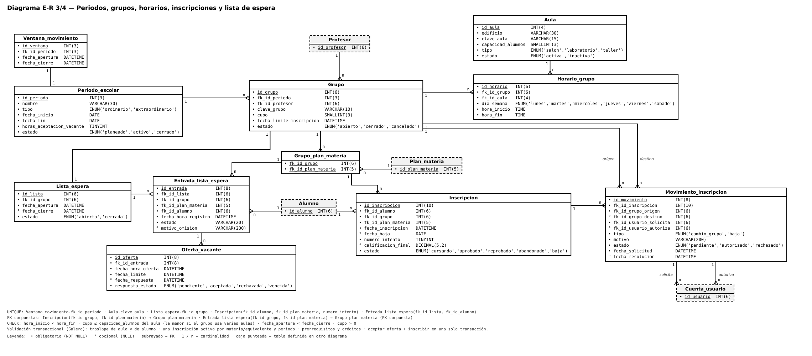
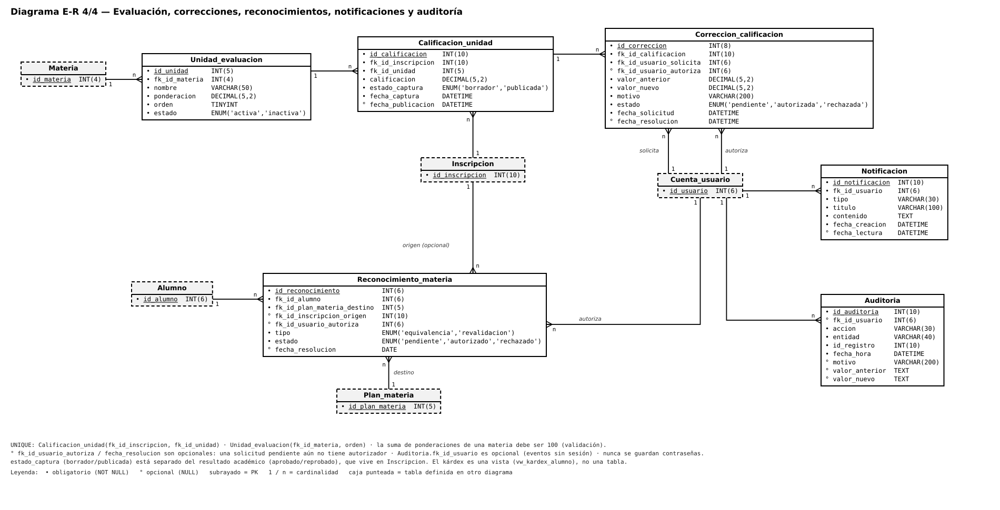

# Diagrama E-R corregido (formato del diagrama original)

**Estado:** propuesta para revisión del equipo, no aprobada. Tamaños de campo y valores de `ENUM` son provisionales.
**Base:** diagrama original del equipo, `diagrama-er-propuesto.md` y `modelo-relacional-propuesto.md`.

> **Nota:** estas imágenes siguen el formato del diagrama original y se hicieron antes de separar `persona`/`empleado`/`personal`/`sesion_usuario`. Para el modelo vigente ver `modelo-relacional-propuesto.md` y `relaciones-y-cardinalidades.md`. Cambios recientes: `Departamento.edificio` y `Alumno.semestre`.

Leyenda: `•` obligatorio, `°` opcional (NULL), subrayado = PK, `1`/`n` = cardinalidad, caja punteada = tabla definida en otro diagrama.

## 1. Usuarios, expedientes y departamentos

## 2. Estructura curricular

## 3. Periodos, grupos, horarios, inscripciones y lista de espera

## 4. Evaluación, correcciones, reconocimientos, notificaciones y auditoría

## Problemas detectados en el diagrama original
- `Cursos.fk_categoria` es `INT(2)` y `Categorias.id_categoria` es `INT(3)`.
- `Datos_contacto_a/p`: la FK no es PK ni UNIQUE, así que la relación 1:1 no se cumple.
- `Calf_modulos.Estado` mezcla estado de entrega con resultado académico.
- Calificaciones `INT(3)` sin decimales; `AUTO_INCREMENT` solo en algunas tablas.
- `Cursos` mezcla materia y oferta por periodo; `Categorias` no tiene función definida.

## Inconsistencias corregidas entre documentos del repo
- `permiso` y `rol_permiso` faltaban en el E-R.
- `entrada_lista_espera` usa FK compuesta (`id_grupo`, `id_plan_materia`) hacia `grupo_plan_materia`.
- `id_usuario_autoriza` (correcciones, reconocimientos) y `Auditoria.id_usuario` pasan a opcionales.
- `Cuenta_usuario` incluye `bloqueado_hasta` y `debe_cambiar_password`.
- Nombre unificado: `fk_id_usuario_solicita` / `fk_id_usuario_autoriza`.

## Pendientes de decisión
- Cupo vs. capacidad cuando un grupo usa varias aulas (propuesta: la menor).
- `fk_id_grupo` repetido en `Entrada_lista_espera` (solo por la FK compuesta).
- Evitar pares repetidos (A,B)/(B,A) en `Equivalencia_materia`.
