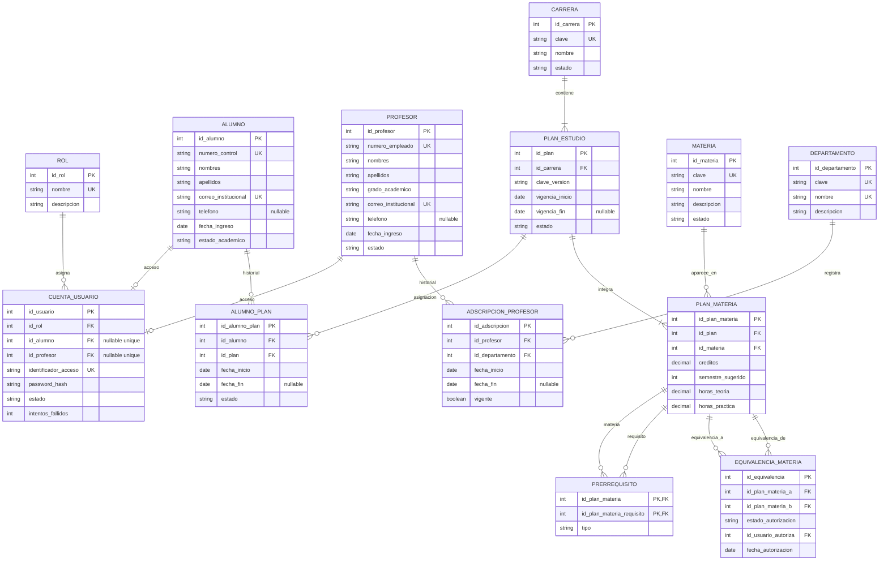
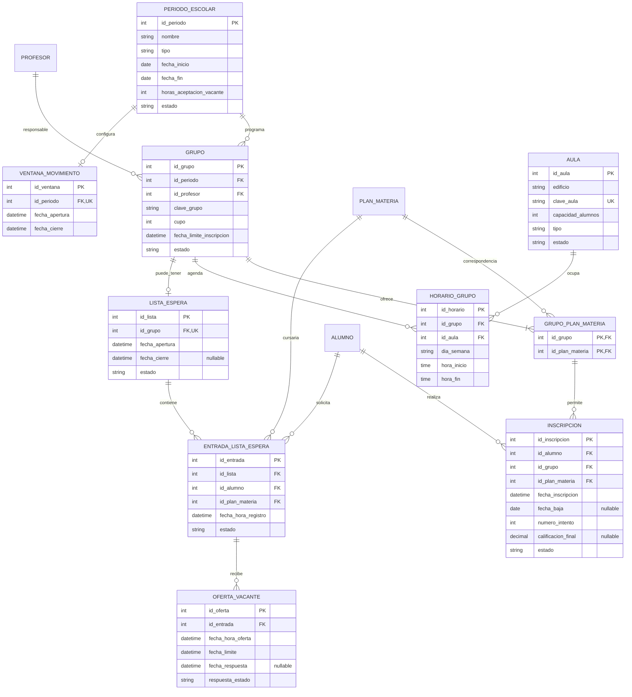
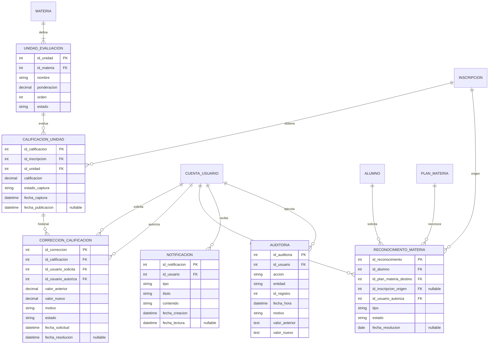

# Diagrama E-R propuesto — Sistema de gestión escolar

**Versión:** 1.0 — propuesta para revisión del equipo.  
**Estado:** modelo conceptual/lógico preliminar; todavía no es el esquema SQL definitivo.  
**Base:** decisiones registradas en `PROJECT_CONTEXT.md` y diagrama E-R original compartido por el equipo.

## Criterio del rediseño

Se conserva lo aprovechable del diagrama original y se adapta a los procesos aprobados:

- `Cursos` se separa en `Materia` (catálogo académico) y `Grupo` (oferta real durante un periodo).
- `Historiales` pasa a ser `Inscripcion`, vinculada a un grupo y a la materia correspondiente al plan del alumno.
- `Horarios` pasa a depender de `Grupo`, con aula, día y hora de inicio/fin.
- `Modulos` se interpreta como `UnidadEvaluacion`; `Calf_modulos` como `CalificacionUnidad`. Esta es una decisión de diseño para continuar; se podrá ajustar si el equipo aclara otra intención.
- Se agregan carreras, planes, periodos, aulas, cuentas/roles, lista de espera, notificaciones y auditoría.
- Teléfono y correo se integran a los expedientes de alumno/profesor; se evita mantener tablas 1:1 de contacto sin necesidad.
- `Categorias` se deja fuera de la primera propuesta porque el diagrama original no explica qué representa ni qué regla controla.

## Diagrama 1. Estructura académica y usuarios

### Notas del diagrama 1

- Una cuenta puede vincularse con un alumno o profesor. Las cuentas de administración y personal institucional pueden no tener esos dos vínculos; usan nombre de usuario o número de empleado como identificador de acceso.
- Cada alumno puede conservar varias asignaciones históricas de plan, pero solo una vigente.
- Cada profesor puede conservar varias adscripciones, pero solo una vigente.
- `PLAN_MATERIA` registra la materia dentro de una versión concreta del plan, con sus créditos y semestre sugerido.
- Las equivalencias entre planes requieren autorización conforme a las reglas institucionales.

## Diagrama 2. Periodos, grupos, horarios, inscripciones y lista de espera

### Notas del diagrama 2

- `GRUPO` es la oferta de una materia en un periodo. `GRUPO_PLAN_MATERIA` permite ofrecer el mismo grupo a materias equivalentes de distintos planes, cuando se autorice.
- `INSCRIPCION` conserva el grupo y la materia del plan del alumno. La pareja `id_grupo` + `id_plan_materia` debe existir en `GRUPO_PLAN_MATERIA` (FK compuesta).
- El cupo del grupo no puede superar la capacidad del aula; para esta regla solo se cuentan alumnos.
- Cada horario pertenece a un grupo y aula; se validan traslapes de aula y choques de horario del alumno.
- La lista de espera usa FIFO por fecha/hora de registro. Si un alumno deja de ser elegible, conserva su posición y se registra el motivo de omisión.
- Una entrada puede recibir varias ofertas a lo largo del tiempo. Cada oferta conserva fecha, vencimiento y respuesta. El plazo inicial es de 24 horas desde la generación del aviso.
- Mientras tenga una oferta pendiente, el alumno no puede mover esa misma materia; sus demás materias no se bloquean.
- La regla de una sola inscripción activa por materia/equivalente en el periodo se valida como regla de negocio y con las restricciones de datos que correspondan.
- `VENTANA_MOVIMIENTO` contiene la apertura y cierre configurados por coordinación académica.

## Diagrama 3. Evaluación, reconocimientos, notificaciones y auditoría

### Notas del diagrama 3

- Las unidades de evaluación son configurables por materia. Las calificaciones pertenecen a una inscripción/intentο concreto.
- `estado_captura` distingue borrador y publicado; no mezcla estos estados con aprobado/reprobado.
- La calificación final se guarda en `INSCRIPCION` como resultado calculado con la fórmula que se valide institucionalmente.
- Una corrección publicada requiere solicitud del profesor y autorización del coordinador; se guarda valor anterior, nuevo, motivo y responsables.
- El kárdex se consulta a partir de inscripciones y reconocimientos históricos; no se crea una tabla redundante para el mismo contenido.
- Las notificaciones no se eliminan definitivamente ni vencen en el alcance inicial; `fecha_lectura` nula indica que no se ha leído.
- La auditoría guarda acciones relevantes, nunca contraseñas ni secretos.

## Correspondencia entre el diagrama original y el propuesto

| Diagrama original | Tratamiento propuesto |
|---|---|
| `Cursos` | Dividir en `Materia` y `Grupo`. Profesor, periodo, cupo y programación pasan al grupo. |
| `Horarios` | Convertir en `HorarioGrupo`, relacionado con grupo y aula; agregar hora de inicio. |
| `Categorias` | Dejar fuera hasta aclarar su función. |
| `Profesores` | Conservar; agregar número de empleado y correo institucional únicos. |
| `Datos_contacto_p` | Integrar correo y teléfono al expediente del profesor. |
| `Departamentos` | Conservar y agregar clave única; registrar cambios mediante `AdscripcionProfesor`. |
| `Modulos` | Convertir en `UnidadEvaluacion`, con la interpretación de unidades de calificación. |
| `Calf_modulos` | Convertir en `CalificacionUnidad`, separando el estado de captura del valor numérico. |
| `Historiales` | Convertir en `Inscripcion`, vinculada a alumno, grupo y materia del plan. |
| `Alumnos` | Conservar; agregar número de control y correo únicos. |
| `Datos_contacto_a` | Integrar correo y teléfono al expediente del alumno. |

## Reglas de integridad que implementaremos

1. PK en cada entidad y FK para todas las relaciones.
2. UNIQUE para número de control, número de empleado, correos institucionales, claves de catálogos y login.
3. Un solo plan vigente por alumno y una sola adscripción vigente por profesor.
4. Un único profesor responsable por grupo en la primera versión.
5. Cupo del grupo menor o igual a capacidad del aula.
6. Evitar traslapes de horario por alumno y por aula.
7. Evitar inscripciones activas duplicadas en la misma materia o equivalente y periodo.
8. Revalidar prerrequisitos, carga de créditos y elegibilidad antes de confirmar una inscripción u ofrecer una vacante.
9. Conservar intentos, calificaciones, reconocimientos, movimientos y auditoría; evitar borrado físico de registros académicos.
10. Probar operaciones concurrentes y consistencia entre los nodos del clúster.

## Pendientes antes del esquema SQL

- Confirmar con las reglas vigentes del ITP/TecNM créditos, seriación, recursamiento, ponderaciones, redondeo y calificación mínima.
- Revisar si la interpretación de `Modulos` como unidades de evaluación corresponde a la intención original del equipo; esta propuesta la adopta para dar continuidad.
- Terminar de definir atributos, tipos de datos, índices, PK/FK compuestas y restricciones de MariaDB.
- Validar la cardinalidad y restricciones de grupos compartidos y materias equivalentes.
- Revisar y aprobar el modelo lógico con el equipo antes de generar scripts SQL.

**Regla:** esta propuesta no debe implementarse directamente. Primero se revisará el modelo, se corregirán las cardinalidades y se aprobará el esquema relacional.
