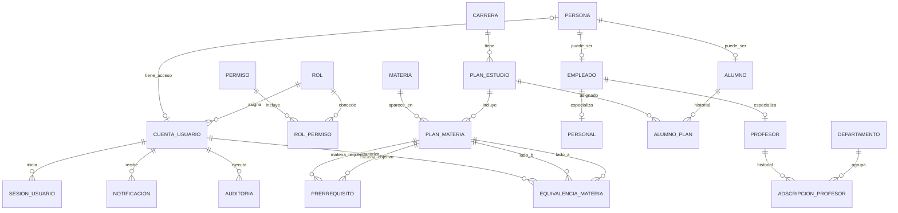
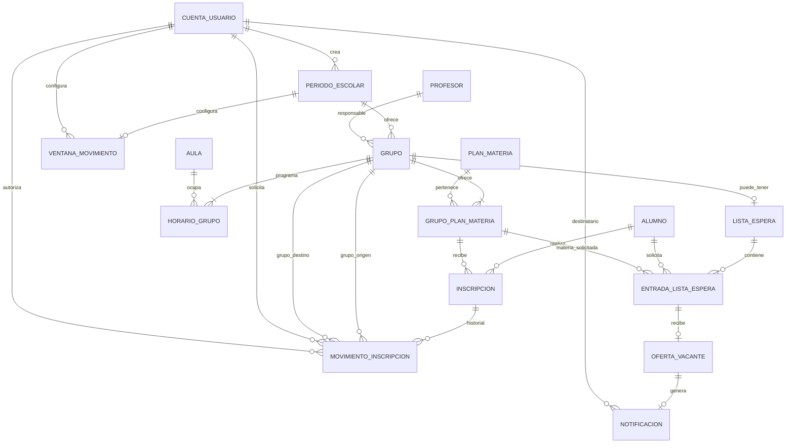
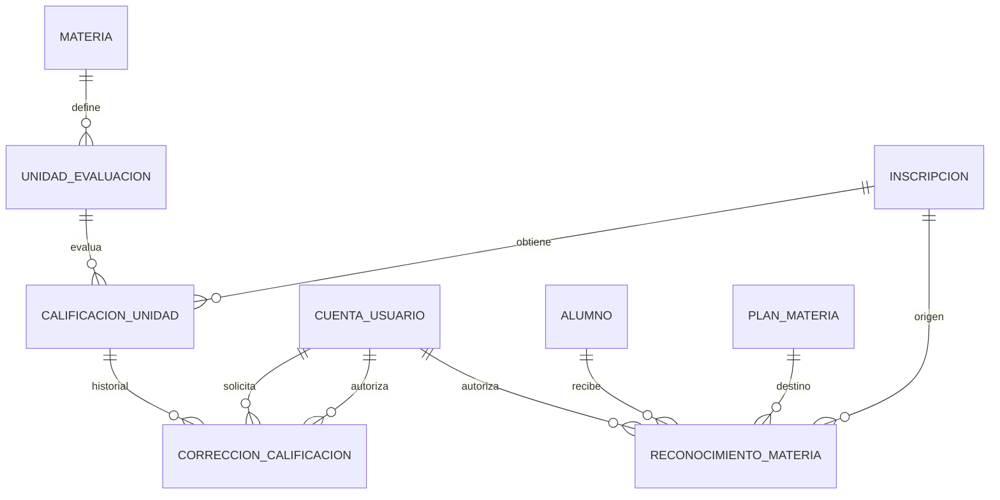
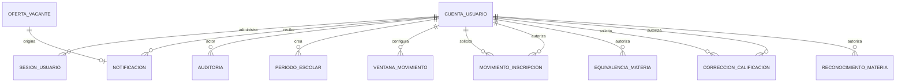

# Diagrama E-R propuesto — Sistema de gestión escolar

**Versión:** 1.1 — revisión integral de relaciones.  
**Estado:** propuesta conceptual/lógica para validación del equipo; todavía no es DDL definitivo.  
**Motor objetivo:** MariaDB con Galera Cluster.

## Criterios del rediseño

- `Cursos` se separa en `Materia` (catálogo) y `Grupo` (oferta concreta de la materia en un periodo).
- `Historiales` se convierte en `Inscripcion`, conservando cada intento de cursado.
- `Horarios` depende de `Grupo` y de `Aula`.
- `Modulos` se interpreta provisionalmente como `UnidadEvaluacion`; `Calf_modulos` como `CalificacionUnidad`.
- Se incorporan carrera, planes, periodos, roles, permisos, cuentas, personas, empleados, personal no docente, lista de espera, ofertas, notificaciones, sesiones y auditoría.
- Los datos de contacto se normalizan en `Persona`, lo que permite que el correo sea único entre alumnos y empleados.
- `Categorias` queda fuera hasta confirmar su significado y utilidad.

## Diagrama 1. Identidad, seguridad y estructura curricular

**Reglas del diagrama 1**

- Cada cuenta tiene un rol. Una persona puede tener como máximo una cuenta; una cuenta administrativa puede existir sin persona asociada, porque su identificador es un nombre de usuario.
- `Persona` concentra nombres, apellidos, correo institucional y teléfono. `Alumno` y `Empleado` son perfiles que extienden a Persona.
- `Empleado` se especializa como `Profesor` o `Personal` no docente (por ejemplo, Servicios Escolares o coordinación académica). En la primera versión, un empleado no se registra en ambos subtipos.
- Una carrera tiene varios planes; un alumno conserva varias asignaciones históricas de plan, pero solo una vigente.
- Un plan tiene materias a través de `PlanMateria`; una materia puede reutilizarse en diferentes planes.
- `Prerrequisito` y `EquivalenciaMateria` son relaciones recursivas N:M entre filas de `PlanMateria`, resueltas por tablas asociativas.
- Las cuentas de los profesores y del personal se vinculan con la misma Persona/Empleado; el rol define si la persona actúa como profesor, Servicios Escolares o coordinación.
- Las relaciones de sesión, notificación, auditoría y autorización se detallan en la matriz completa de relaciones.

## Diagrama 2. Periodos, oferta, grupos, horarios e inscripciones

**Reglas del diagrama 2**

- Cada grupo pertenece a un periodo y tiene un solo profesor responsable.
- `GrupoPlanMateria` resuelve la relación N:M entre grupo y materia del plan. Permite compartir un grupo entre planes únicamente cuando la equivalencia haya sido autorizada.
- Cada grupo presencial tendrá uno o varios bloques de horario; cada bloque se realiza en un aula. El cupo del grupo no puede superar la capacidad para alumnos del aula.
- Cada inscripción pertenece a un alumno y a una combinación válida de grupo y materia del plan, garantizada mediante FK compuesta.
- Los cambios y bajas se conservan en `MovimientoInscripcion`; un cambio registra grupo origen y destino; una baja no tiene grupo destino. El movimiento identifica solicitante y, cuando aplica, autorizador.
- Un grupo puede no tener lista de espera o tener una; las entradas se ordenan FIFO. Cada entrada se refiere a una materia de plan que el grupo realmente ofrece.
- Una entrada recibe como máximo una oferta. Si el alumno rechaza o deja vencer su oferta, pasa al siguiente elegible. Si fue omitido por no cumplir requisitos, conserva su posición y podrá revalidarse en otra vacante.
- Cada oferta genera una notificación de vacante. Las notificaciones académicas generales no necesitan estar vinculadas a una oferta.

## Diagrama 3. Evaluación, reconocimientos, correcciones y trazabilidad

**Reglas del diagrama 3**

- Cada unidad de evaluación pertenece a una materia; las calificaciones pertenecen a una inscripción/intento y a una unidad de esa materia.
- El estado de captura distingue borrador y publicada. No se mezcla con aprobado/reprobado.
- La calificación final se obtiene de las unidades publicadas conforme a la fórmula oficial que se verifique; puede conservarse como resultado calculado en la inscripción.
- Cada corrección se asocia con una calificación, una cuenta solicitante y una cuenta que resuelve/autorizador. Mientras esté pendiente, el autorizador puede ser NULL.
- Un reconocimiento pertenece a un alumno y a una materia destino del plan; la inscripción de origen es opcional para antecedentes externos. El autorizador queda registrado.
- Las relaciones de notificaciones y auditoría con cuenta/objeto están explicitadas en los diagramas 1 y 2 y en la matriz completa.

## Diagrama 4. Relaciones operativas entre cuentas y procesos

**Nota:** las cuentas son actores transversales de los procesos. Se muestran juntas aquí para facilitar la revisión, aunque algunas de esas relaciones también aparecen en los diagramas de su módulo funcional.

## Correspondencia con el diagrama original

| Elemento original | Tratamiento |
|---|---|
| `Cursos` | Separar en `Materia` y `Grupo`. El profesor, periodo, cupo y programación pertenecen al grupo. |
| `Horarios` | Convertir en `HorarioGrupo`, con aula, día, hora de inicio y fin. |
| `Categorias` | No incluir hasta confirmar su significado académico. |
| `Profesores` | Conservar como perfil de `Empleado`; agregar vínculo común a `Persona`. |
| `Datos_contacto_p` | Integrar correo y teléfono a `Persona`. |
| `Departamentos` | Conservar; el historial de adscripción se guarda en `AdscripcionProfesor`. |
| `Modulos` | Interpretar provisionalmente como `UnidadEvaluacion`. |
| `Calf_modulos` | Convertir en `CalificacionUnidad`, separando valor y estado de captura. |
| `Historiales` | Convertir en `Inscripcion`, vinculada a alumno, grupo y materia del plan. |
| `Alumnos` | Conservar como perfil de `Persona`, con número de control único. |
| `Datos_contacto_a` | Integrar correo y teléfono a `Persona`. |

## Auditoría de conectividad

La lista completa de relaciones R01–R55, con cardinalidad, optionalidad y FK concreta, está en [relaciones-y-cardinalidades.md](./relaciones-y-cardinalidades.md). Esa matriz es la referencia para contrastar el diagrama y el modelo relacional.

**Resultado de revisión:** todas las entidades candidatas están conectadas al menos a otra entidad. Los vínculos opcionales (cuentas administrativas sin persona, alumnos/empleados sin cuenta, ventanas aún no configuradas, destino de baja, reconocimiento sin inscripción de origen y notificaciones generales sin oferta) son intencionales y están documentados. La auditoría referencia al objeto de negocio mediante tipo de entidad + id de registro, una relación polimórfica explicada en la matriz.

## Pendiente antes de SQL

- Confirmar reglas oficiales de créditos, seriación, recursamiento, ponderaciones, redondeo, calificación mínima y equivalencias.
- Validar atributos y restricciones finales, incluidas las FK compuestas.
- Revisar con el equipo si `Modulos` representa unidades de evaluación.
- Aprobar el modelo lógico y después traducirlo a DDL MariaDB.
